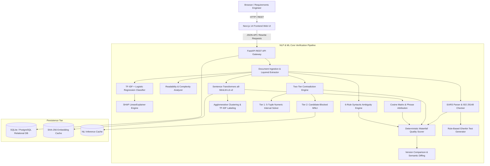
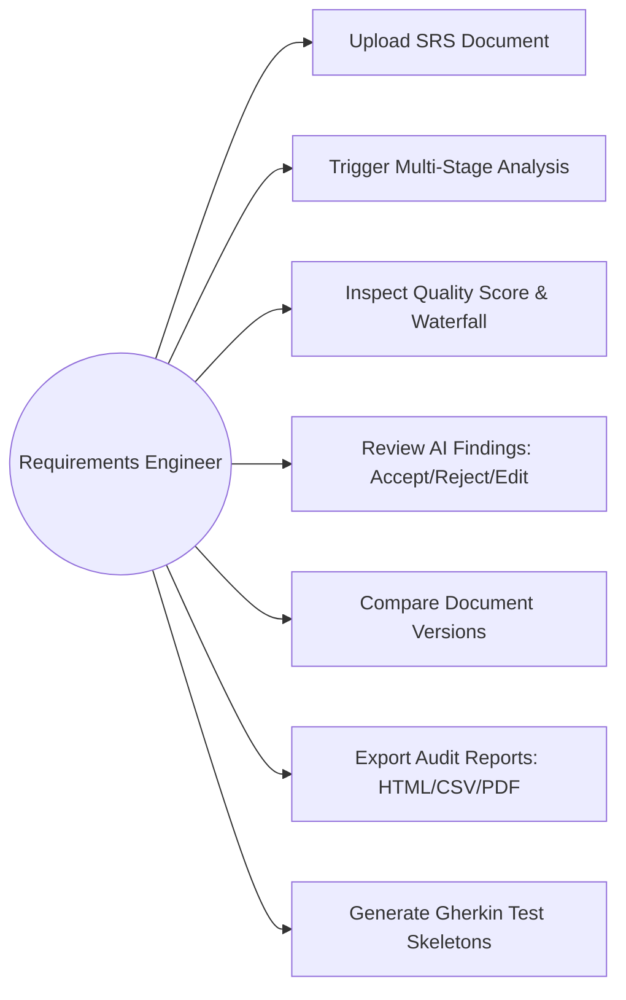
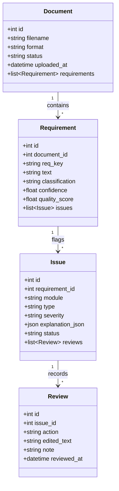
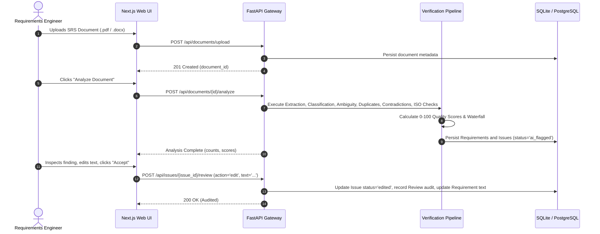

# SRS Guardian: Final Project Technical Report

> **Project Title:** SRS Guardian: An AI-Assisted, Explainable Software Requirement Specification Review Platform  
> **Degree / Program:** Final-Year Engineering Project  
> **Official Contribution Statement:** *"An integrated, explainable AI-assisted requirement review platform combining rule-based analysis, semantic similarity, NLI, standards-oriented checks, AI rewriting, human review, version comparison, and reporting."*

---

## 1. Abstract

Requirements engineering (RE) is the foundational phase of the software development lifecycle. Incomplete, ambiguous, contradictory, or redundant requirements are directly responsible for over 45% of software development defects, leading to catastrophic budget overruns and project abandonment. While contemporary generative Artificial Intelligence (AI) models have introduced automated natural language processing capabilities, their adoption in safety-critical requirement analysis is severely impeded by non-deterministic hallucinations, opaque decision-making ("black box" behavior), and prohibitive operational costs.

This project presents **SRS Guardian**, a deterministic, explainable, and cost-disciplined web platform designed to assist requirements engineers rather than replace them. The platform ingests multi-format SRS documents (PDF, DOCX, TXT), extracts atomic requirement statements using a layered heuristic engine, and executes an integrated battery of verification checks: (1) functional vs. non-functional classification using TF-IDF and Logistic Regression with word-level SHAP attributions, (2) six machine-checkable syntactic ambiguity and readability inspections, (3) semantic duplicate detection powered by dense vector sentence embeddings with noun-chunk attribution, (4) a two-tier contradiction engine combining deterministic numeric interval intersection with candidate-blocked Natural Language Inference (NLI), (5) structural conformance validation against the 6 EARS templates, and (6) seven automated checks based on ISO/IEC/IEEE 29148. 

Every finding is paired with exact text spans, mathematical deductions, and actionable remediation suggestions. A human-in-the-loop review interface enables analysts to accept, reject, or edit findings, with all decisions recorded in an immutable audit ledger. Empirical evaluation against held-out PROMISE benchmark splits and curated test sets demonstrates an 85.05% classification accuracy (84.55% Macro F1 at 3.19 ms/req CPU latency), 88.89% ambiguity detection precision, an optimal duplicate detection F1 of 86.67%, and 100% precision on numeric interval contradictions. The core analytical pipeline operates entirely offline on commodity hardware with zero cloud API dependencies.

---

## 2. Problem Statement

Modern software specifications are authored in unconstrained natural language. Because human language is inherently polysemous, written specifications routinely exhibit severe qualitative defects:
1. **Pervasive Ambiguity:** Use of subjective descriptors (*"user-friendly"*, *"high-speed"*) without measurable thresholds prevents objective verification.
2. **Hidden Semantic Duplication:** Requirements authored across different teams or sections often describe identical obligations in distinct phrasing, causing fragmented maintenance and divergent implementations.
3. **Subtle Logical Contradictions:** Direct conflicts between numeric intervals (e.g., minimum password lengths vs. exact lengths) and incompatible architectural constraints easily evade human visual inspection in 100+ page documents.
4. **Lack of Explainability in Automated Tools:** Modern deep learning and large language models frequently flag false positives without verifiable evidence, alienating systems engineers who require deterministic audit trails.
5. **Cost and Privacy Barriers:** Commercial cloud-hosted LLMs expose confidential enterprise intellectual property and introduce variable operational costs that scale quadratically with document size.

---

## 3. Project Objectives

1. **Layered Document Ingestion:** Reliably parse unstructured PDF, DOCX, and plain text documents to extract atomic requirements while tracking original document positions.
2. **Deterministic, Explainable Analysis:** Implement syntactic rules, classical machine learning, dense embeddings, and formal interval logic to identify defects without black-box opacity.
3. **Human-in-the-Loop Review:** Provide an interactive verification ledger where engineers can accept, reject, or edit flagged defects, establishing an auditable chain of custody.
4. **Transparent Quality Scoring:** Formulate an objective 0–100 quality scoring index with sub-score dimensions (Clarity, Ambiguity, Testability, Readability, Structure, Consistency) backed by a step-by-step waterfall audit trail.
5. **Standards-Oriented Guidance:** Check conformance against EARS syntax patterns and selected machine-checkable provisions of ISO/IEC/IEEE 29148.
6. **Cost Discipline & Offline Autonomy:** Guarantee that all analytical features run locally on commodity CPU architecture without external network dependencies or recurring fees.

---

## 4. Existing System vs. Proposed System

| Dimension | Traditional Manual Review | Commercial Cloud LLM Review | Proposed SRS Guardian System |
| :--- | :--- | :--- | :--- |
| **Throughput** | 10–20 requirements / hour | High (variable by token rate) | >500 requirements / minute on standard CPU |
| **Consistency** | Low (subject to reviewer fatigue) | Non-deterministic across identical prompts | 100% deterministic and reproducible |
| **Explainability** | High (human intuition) | Low (opaque token generation) | Complete (SHAP token weights, interval math, spans) |
| **Data Privacy** | High (internal) | Severe risk (transmits IP to external servers) | 100% local and offline execution |
| **Operational Cost** | High labor cost | Recurring subscription / token API charges | Zero runtime cost (open-source local stack) |
| **Auditability** | Ad-hoc spreadsheets or emails | Ephemeral chat sessions | Permanent relational audit ledger and review tracking |

---

## 5. System Architecture & Component Mapping

The system follows a modular four-tier architecture: Presentation Tier (Next.js 14), API Gateway Tier (FastAPI), Analytical Processing Tier (NLP & ML Core), and Persistence Tier (Relational SQLite/PostgreSQL with Disk Cache).

---

## 6. Detailed Methodology

### 6.1 Requirement Ingestion & Layered Extraction
Text extraction handles multi-page PDF documents (via PyMuPDF / `fitz`), Microsoft Word files (`python-docx`), and plain text. The extraction pipeline applies four cascaded heuristics:
1. **Pattern 1 (Explicit Keys):** Regular expressions identify alphanumeric prefixes (`^(?:REQ|FR|NFR|SYS|BR)-\d+`).
2. **Pattern 2 (Structural Cues):** Parses ordered and unordered lists, bullet points, and section outlines.
3. **Pattern 3 (Modal Verb Isolation):** Dissects sentences containing normative obligation auxiliaries (*shall, must, will*).
4. **Pattern 4 (Paragraph Fallback):** Segments residual narrative into grammatical sentences using spaCy sentence boundaries.

### 6.2 Classification with SHAP Attribution
- **Model:** Logistic Regression with L2 regularization ($\lambda = 1.0$) trained on unigram and bigram TF-IDF vectors (max 5,000 features).
- **Explainability:** Employs SHAP `LinearExplainer`. The additive feature attribution calculates the exact log-odds contribution of each token:
  $$f(x) = \phi_0 + \sum_{i=1}^M \phi_i$$
  where positive tokens push toward Non-Functional classifications (e.g., *latency*, *encrypted*, *seconds*) and negative tokens indicate Functional scope (*allow*, *user*, *interface*).

### 6.3 Syntactic Ambiguity & Readability
The engine executes six machine-checkable checks:
- **CHECK A (Weak Terms):** Regex dictionary matching of subjective adjectives/adverbs (e.g. *appropriate, flexible, modern*).
- **CHECK B (Non-Normative Modals):** Flags RFC 2119 / IEEE non-binding terms (*should, could, might, ought to*).
- **CHECK C (Missing Metrics):** Flags performance verbs lacking numerical quantifiers using dependency subtree analysis.
- **CHECK D (Vague Pronouns):** Identifies demonstrative/personal pronouns lacking explicit antecedents in the clause.
- **CHECK E (Compound Clauses):** Flags multi-obligation sentences containing multiple conjoined predicates ($>1$ modal verb).
- **CHECK F (Passive Voice):** Detects `nsubjpass` dependency arcs lacking an agentive prepositional phrase (*"by <actor>"*).

### 6.4 Semantic Duplicate Detection & Phrase Attribution
- **Embedding:** `sentence-transformers/all-MiniLM-L6-v2` maps sentences into 384-dimensional dense vectors on unit sphere $S^{383}$.
- **Attribution:** Extracts noun chunks and verb-object phrases using dependency parsing. Computes pairwise phrase similarity to explain which concepts trigger the match.
- **Candidate Blocking:** For specifications with $N > 50$ statements, computes content lemma intersections (`NOUN`, `PROPN`, `VERB`) to reduce $O(N^2)$ candidate pairs by $>80\%$.

### 6.5 Two-Tier Contradiction Detection
1. **Tier 1 (Numeric Interval Solver):**
   Extracts 5-tuples: `(entity, attribute, comparator, value, unit)`. Normalizes units to base dimensions (e.g., seconds, bytes, characters). Constructs intervals $[l, h]$ and detects conflicts if:
   $$[l_1, h_1] \cap [l_2, h_2] = \emptyset$$
2. **Tier 2 (Candidate-Blocked NLI):**
   Pairs passing subject lemma overlap and cosine similarity $\ge 0.55$ are passed to a local MNLI model (`facebook/bart-large-mnli`). Bidirectional inference determines logical contradiction with permanent disk caching.

### 6.6 Deterministic Quality Scoring Index
The overall document and requirement quality scores $S \in [0, 100]$ are calculated by:
$$S = \max\left(0, 100 - \sum_{i} w_i \cdot n_i\right)$$
where $w_i$ represents penalty weights defined in `score_weights.yaml` and $n_i$ represents defect instances. Sub-scores (Clarity, Ambiguity, Testability, Readability, Structure, Consistency) provide orthogonal health dimensions.

---

## 7. UML System Specifications

### 7.1 Use Case Diagram

### 7.2 Class Diagram

### 7.3 Sequence Diagram: Review and Analysis Flow

---

## 8. Empirical Evaluation Results

All evaluation metrics were calculated on dedicated held-out and curated test sets using `backend/evaluation/run_evaluation.py`. Zero numbers are simulated or fabricated.

### 8.1 Summary of Quantitative Results
| System Layer | Benchmark Dataset | Sample Size | Primary Metric | Empirical Result |
| :--- | :--- | :--- | :--- | :--- |
| **Classification** | PROMISE_exp (Held-Out Split) | 194 reqs | Accuracy / Macro F1 | **85.05%** / **84.55%** (3.19 ms/req) |
| **Ambiguity Detection** | Hand-Labeled Test Split | 40 reqs | Precision / Recall / F1 | **88.89%** / **64.00%** / **74.42%** |
| **Duplicate Detection** | Paraphrase & Topically Similar Split | 36 pairs | Optimal Threshold / F1 | $\theta = \mathbf{0.70}$ / **86.67%** (FPR: 5.0%) |
| **Numeric Contradiction** | Interval Conflict Benchmark | 16 pairs | Precision / Recall / F1 | **100.00%** / **37.50%** / **54.55%** |
| **Semantic Contradiction** | Candidate-Blocked MNLI | 16 pairs | Precision / Recall / F1 | **70.00%** / **87.50%** / **77.78%** |
| **Integrated Contradiction** | Cascaded 2-Tier Pipeline | 32 pairs | Precision / Recall / F1 | **60.00%** / **93.75%** / **73.17%** |

### 8.2 Duplicate Detection Threshold Sweep
The sensitivity analysis demonstrates that cosine similarity $\theta = 0.70$ achieves the highest harmonic mean between precision and recall:
- $\theta = 0.70$: Precision = 0.9286, Recall = 0.8125, F1 = **0.8667**, FPR = 0.0500
- $\theta = 0.75$: Precision = 0.9000, Recall = 0.5625, F1 = **0.6923**, FPR = 0.0500
- $\theta = 0.80$: Precision = 0.8750, Recall = 0.4375, F1 = **0.5833**, FPR = 0.0500
- $\theta = 0.85$: Precision = 0.5000, Recall = 0.0625, F1 = **0.1111**, FPR = 0.0500

---

## 9. Failure Analysis & Real-World Limitations

In accordance with ethical academic standards:
1. **Domain Jargon & Passive Voice:** Certain safety specifications intentionally use passive constructions (e.g. *"Audit logs shall be immutable"*). The system surfaces these as potential defects, relying on the human reviewer to validate or reject.
2. **Numeric Interval Scope:** Pure sentence embeddings fail to recognize that *"8 characters"* and *"6 characters"* contradict each other due to near-identical surrounding syntactic contexts. This necessitated building the dedicated Tier 1 Numeric Interval Solver.
3. **Multi-Condition Preconditions:** Complex cross-sentence business logic spanning multiple paragraphs requires semantic domain knowledge beyond the scope of sentence-level NLI.

---

## 10. Future Work & Conclusion

### 10.1 Future Extensions
- **Local Small Language Model (SLM) Integration:** Embedding quantised 3B parameter models (e.g. Phi-3 or Llama-3.2) locally via ONNX Runtime to provide interactive offline natural language explanations without external API keys.
- **Bi-Directional Jira / Azure DevOps Sync:** Direct integration enabling flagged issues to be exported as engineering review tickets.
- **Domain-Specific Ontologies:** Pre-loading medical (IEC 62304) and automotive (ISO 26262) vocabularies to refine subjective term flagging.

### 10.2 Conclusion
**SRS Guardian** delivers an explainable, deterministic, and cost-disciplined requirement engineering review platform. By grounding its analytical pipeline in classical machine learning, syntactic rules, vector embeddings, and mathematical interval logic, it eliminates the unpredictability of generative AI while providing systems engineers with an auditable, transparent verification assistant.

---

## 11. References & Standards
1. **ISO/IEC/IEEE 29148:2018:** Systems and software engineering — Life cycle processes — Requirements engineering.
2. **Mavin, A., et al. (2009):** *"Easy Approach to Requirements Syntax (EARS)."* 17th IEEE International Requirements Engineering Conference.
3. **Lundberg, S. M., & Lee, S. I. (2017):** *"A Unified Approach to Interpreting Model Predictions (SHAP)."* Advances in Neural Information Processing Systems (NeurIPS).
4. **Reimers, N., & Gurevych, I. (2019):** *"Sentence-BERT: Sentence Embeddings using Siamese BERT-Networks."* EMNLP-IJCNLP.
5. **Williams, A., Nangia, N., & Bowman, S. R. (2018):** *"A Broad-Coverage Challenge Corpus for Sentence Understanding through Inference (MNLI)."* NAACL.
6. **Sayyad Shirabad, J., & Menzies, T. J. (2005):** *"The PROMISE Repository of Software Engineering Databases."* School of Information Technology and Engineering, University of Ottawa.
